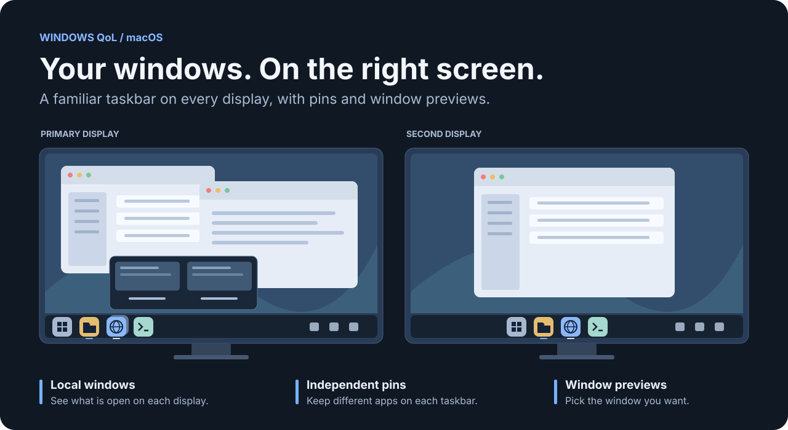
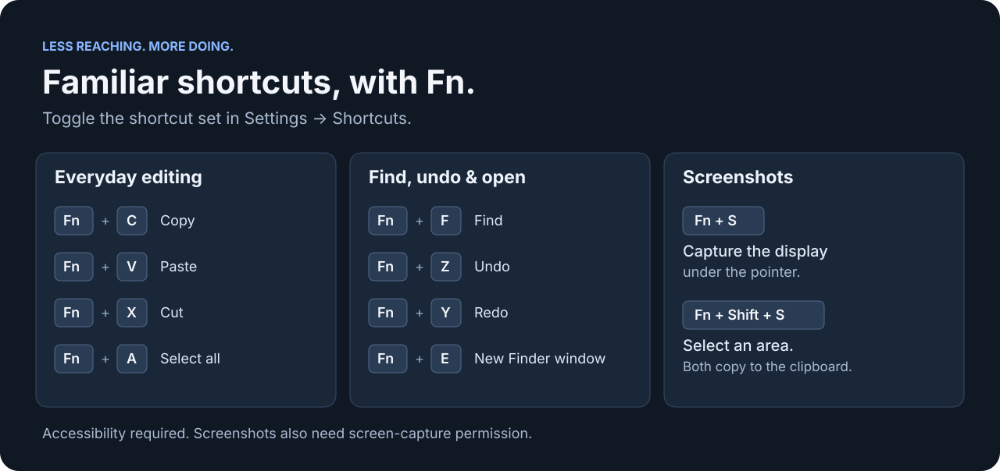

# Windows QoL for macOS

Windows-style desktop conveniences, built as a native Swift and AppKit menu-bar app. Get a taskbar on every display, switch between windows with previews, and keep familiar shortcuts close at hand.



*Illustrated overview, not an app screenshot.*

**Early prototype · Build from source · macOS**

[Features](#features) · [Get started](#get-started) · [Permissions](#permissions) · [Shortcuts](#shortcuts) · [Troubleshooting](#troubleshooting) · [Limitations](#limitations)

## Features

### A taskbar on every display

Each taskbar shows the apps with windows on that display. Move a window between monitors and its taskbar entry follows, usually within a second.

- **Separate pins per display.** Keep different apps on each monitor. Right-click an app to pin or unpin it, then drag pinned icons to reorder them.
- **Standard or centered layout.** Choose left-aligned icons or a centered group, with adjustable spacing that contracts when space is limited.
- **Window indicators and badges.** A line marks visible local windows, a dot marks minimized-only windows, and blue highlights the frontmost local window. The taskbar also mirrors meaningful notification badge text exposed by the native Dock.
- **Quick access.** Open Spotlight, Finder, a new Terminal window, System Settings or Trash. Finder and Terminal also offer shortcuts to Desktop, Downloads, Documents and Home from their context menus.
- **Optional focus across monitors.** Enable “Activate windows when moving between monitors” to focus the frontmost window when the pointer enters another display's window area.

To pin an app from settings, bring it to the front, then choose **Settings… → Taskbar → Pin last used app**. Secondary taskbars offer both primary-taskbar and current-taskbar pin options in their context menus.

### Switch windows, not just apps

An app with multiple local windows gets a stacked icon. Hover over or click it to open a horizontal preview chooser, then select the window you want. Each preview also has a close button.

| Action | Behavior |
| --- | --- |
| Click an icon with one local window | Minimize it if it is the frontmost window on that display; otherwise restore or focus it. |
| Hover over an icon with local windows | Open the window preview chooser. |
| Click an icon with multiple local windows | Open the chooser without minimizing a window. |
| Right-click a running app | Manage pins, open a new window when the app exposes that action, or quit the app. Stacked apps also offer **Close All Windows**, which applies across displays. |
| Click a pinned app with windows only on another display | Focus an existing window on that display. |

Real window thumbnails require screen-capture permission and macOS 14 or later. When a suitable capture is unavailable, previews use the app icon instead.

### Make room above the taskbar

Windows that span almost the full display height are shortened to sit above the taskbar after you finish dragging or resizing them. Double-click an unmodified title bar to animate a window into a taskbar-aware maximized frame; double-click again to restore its previous frame.

If no previous frame is available, restore uses a centered, smaller frame. This is a best-effort Accessibility feature: full-screen Spaces, interactive title-bar controls and apps that refuse resizing are excluded.

### Open Terminal from Finder

The bundled Finder extension adds **Open Terminal Here** when you right-click empty space in a folder or a single selected folder.

Enable it under **System Settings → General → Login Items & Extensions → Finder** if needed. The location and wording vary with macOS. Virtual folders and some cloud-provider locations may not offer the action.

## Get started

The current setup is a local build. You need macOS and Apple's Command Line Tools; full Xcode is not required.

1. Install the Command Line Tools if you do not already have them:

   ```sh
   xcode-select --install
   ```

2. Clone and build:

   ```sh
   git clone https://github.com/dano1066/macbook-windows-qol.git
   cd macbook-windows-qol
   ./scripts/build.sh
   open 'build/Windows QoL.app'
   ```

3. Find the **four-pane icon** in the menu bar and open **Settings… → Permissions**. Grant the permissions needed for the features you want, then quit and reopen the app if macOS requests it.

The app is built at `build/Windows QoL.app`. It uses an ad-hoc local signature, rather than an authenticated developer identity. Rebuilds can sometimes require Accessibility permission to be refreshed.

**Startup changes your native Dock settings.** Windows QoL hides the Dock and temporarily increases its edge-reveal delay. Read [Native Dock behavior](#native-dock-behavior) before running it.

### Settings and everyday controls

The menu-bar menu contains **Settings…**, **Reload Windows QoL** and **Quit Windows QoL**.

| Settings section | Controls |
| --- | --- |
| **General** | Open at login. Requires macOS 13 or later; macOS may require approval. |
| **Taskbar** | Layout, spacing, monitor-entry focus and primary-taskbar pins. |
| **Shortcuts** | Enable or disable the Windows-style Fn shortcuts. |
| **Permissions** | Check Accessibility and screen-capture access and request permission. |

**Reload** quits normally and reopens the existing build. It does not compile source changes. After updating the source, quit the app, run `./scripts/build.sh`, then reopen `build/Windows QoL.app`.

## Permissions

Windows QoL uses macOS permissions to work with other apps. Grant access through System Settings; the app cannot grant it itself.

| Permission | Used for |
| --- | --- |
| **Accessibility** | Detecting, focusing, minimizing, moving and resizing windows; reading Dock badges; handling Fn shortcuts and title-bar double-clicks. |
| **Screen Recording / Screen & System Audio Recording** | Window thumbnails and display screenshots. This permission grants broader screen access. |
| **Automation** | Controlling System Events for the Dock, and Finder or Terminal when opening new windows. macOS may prompt when you first use an action. |
| **Finder extension enablement** | Showing **Open Terminal Here** in supported Finder context menus. |

Without Accessibility, taskbar launchers can still be available, but window controls and Fn shortcuts will not work. Screen-capture access is optional if you do not need thumbnails or screenshots.

macOS owns its permission lists. If requesting access does not create an entry, use the **+** button in the relevant privacy pane to add `build/Windows QoL.app` manually where supported.

## Shortcuts

Enable or disable these together in **Settings… → Shortcuts**. Fn-C and Fn-A replace macOS's Control Centre and Dock shortcuts while enabled.



| Shortcut | Action |
| --- | --- |
| **Fn-C / V / X** | Copy, paste and cut. |
| **Fn-A** | Select all. |
| **Fn-Z / Y** | Undo and redo. |
| **Fn-F** | Find. |
| **Fn-E** | Open a new Finder window. |
| **Fn-S** | Copy a screenshot of the display under the pointer to the clipboard. |
| **Fn-Shift-S** | Start macOS's area screenshot tool and copy the result to the clipboard. |

Secure Input, applications, macOS or the keyboard itself may intercept a shortcut. When Secure Input is detected as Fn is pressed, the app displays a notice; standard Command shortcuts remain useful alternatives.

## Native Dock behavior

macOS has one native Dock. The button at the far right of a taskbar toggles its **automatically hide and show** setting globally; it does not move the Dock to the clicked monitor.

- **On startup:** the app hides the Dock and sets its edge-reveal delay to 1,000 seconds to reduce accidental reveals.
- **While running:** the Dock toggle uses System Events and avoids restarting the Dock on every click. It may need Automation permission.
- **On a normal quit:** the app restores the saved reveal delay, provided that setting still has the app's temporary value, and makes the Dock visible. The Dock restarts briefly.
- **On reload:** normal shutdown runs before the app opens again, so the Dock can briefly reappear and restart.
- **After a crash or force quit:** shutdown cleanup cannot run. Reopen the app and quit normally to restore the Dock.

To make the native Dock visible immediately if recovery is needed:

```sh
defaults write com.apple.dock autohide -bool false && killall Dock
```

This changes the system-wide Dock auto-hide setting and restarts the Dock.

## Troubleshooting

**The taskbar appears, but window controls do nothing.** Check **Settings… → Permissions → Accessibility**. Confirm the allowed app is the current `build/Windows QoL.app`, then quit and reopen it. If macOS shows access enabled but the app still reports no access, rebuilding or restarting alone may not resolve a cached permission identity.

**Previews show app icons.** Check screen-capture permission. Real thumbnails require macOS 14 or later, a non-minimized window and an unambiguous match between the tracked window and the capture source.

**Open Terminal Here is missing or duplicated.** Check Finder extension enablement. Finder can cache an older extension after a rebuild; restarting Finder can refresh it, but may disrupt open Finder windows. Some virtual or cloud locations do not support the action.

**A shortcut does not fire.** Check Accessibility access, the shortcut toggle and whether Secure Input is active. Try the native Command shortcut. Screenshots need screen-capture access; opening Finder may need Automation access.

**Open at login runs twice.** If you previously added a manual login item, remove that duplicate from System Settings before using the app's own login setting.

**A window overlaps the bar.** macOS does not reserve desktop space for this taskbar. The app adjusts matching near-full-height windows, but ordinary windows, custom app layouts and apps that refuse resizing can still overlap it.

## Limitations

This is an early prototype, developed around a personal desktop workflow. Expect differences between apps, macOS versions, keyboards and monitor arrangements.

- Window tracking depends on the Accessibility information each app exposes. Hidden apps, unusual dialogs, other Spaces and full-screen windows may behave differently or be omitted.
- Minimized windows retain their last known display during a session. Windows already minimized at startup may have no usable position.
- Restoring a window returns it to its previous size; it does not automatically maximize it.
- A crowded taskbar clips excess icons rather than scrolling. The multi-window preview chooser can scroll horizontally.
- A taskbar and the native Dock can overlap content. The custom bar does not reserve a macOS desktop work area.
- Platform requirements vary by feature: launch at login needs macOS 13 or later; real window thumbnails need macOS 14 or later. A declared build minimum is not a guarantee of testing on every older macOS release.

## Reporting a problem

[Open an issue](https://github.com/dano1066/macbook-windows-qol/issues) with your macOS version, the affected app, monitor arrangement, reproduction steps and relevant permission status. Crop screenshots to the affected UI and remove private window titles or document contents before sharing them.
